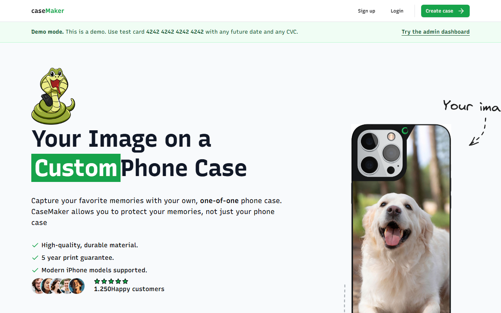
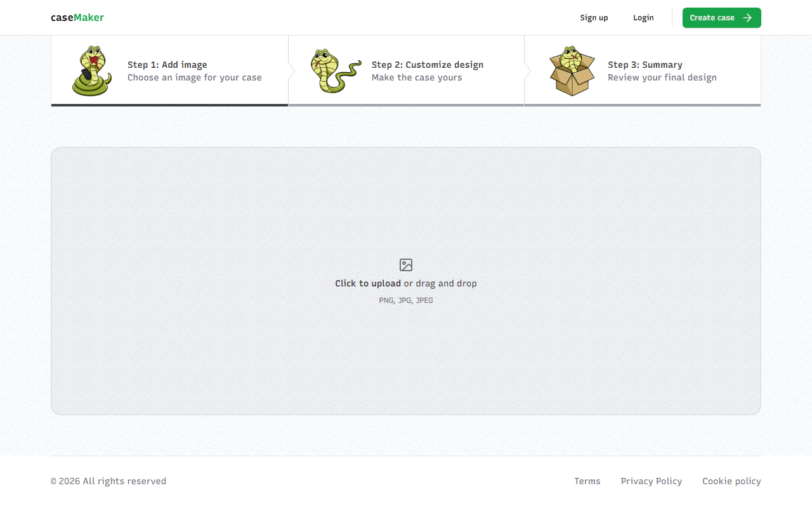
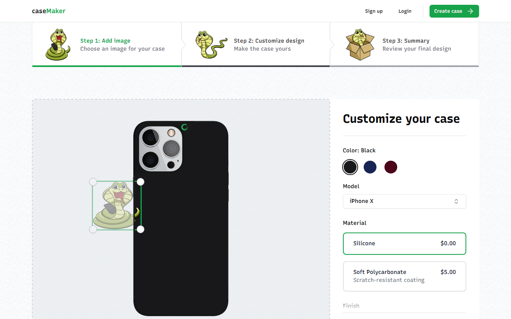
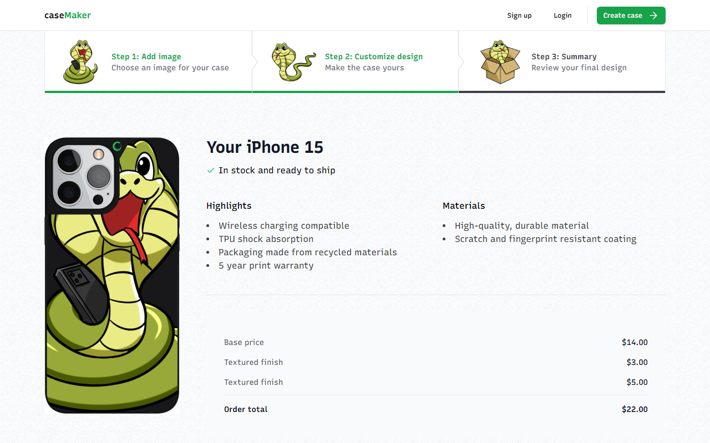
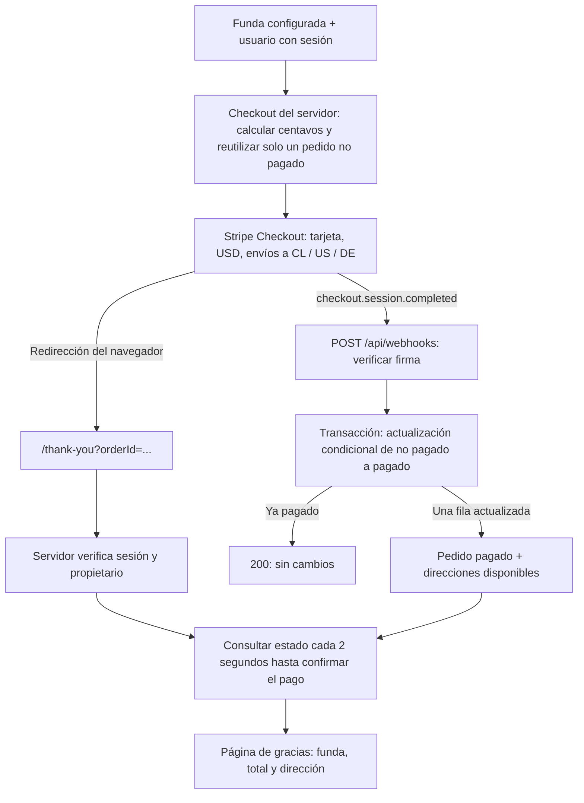

# PhoneCaseMaker

[English](README.md)

Una tienda de fundas personalizadas: sube una imagen, ajústala sobre una funda, elige modelo y acabado, y paga con Stripe. Este proyecto de portafolio se centra en pagos correctos, autorización en el servidor y un panel de administración con modo demo.

## Demo

<!-- TODO(owner): URL de la demo -->

El enlace a la demo pública se añadirá cuando esté desplegada. Con `DEMO_MODE=true`, la portada muestra la tarjeta de prueba de Stripe **4242 4242 4242 4242**. Usa cualquier fecha de vencimiento futura y cualquier CVC en el modo de prueba de Stripe.

Inicia sesión con Kinde para completar el pago o entrar a `/dashboard`; no hay una cuenta pública de administrador. Un visitante con sesión ve los pedidos de ejemplo y sus propios pedidos pagados, y solo puede actualizar los suyos. Los pedidos de ejemplo son de solo lectura para todos, incluido el administrador. El seed crea ocho pedidos pagados para tres usuarios ficticios `@example.com`; son datos de ejemplo, no credenciales de acceso.

## Capturas

Estas capturas de 1280 × 800 se generan con `npm run screenshots` (requiere PostgreSQL).

| Portada | Subida |
| --- | --- |
|  |  |

| Diseño | Previsualización |
| --- | --- |
|  |  |

## Flujo de pago



La redirección del navegador y el webhook pueden llegar en cualquier orden. La página de gracias espera la confirmación del webhook; la redirección por sí sola no marca el pedido como pagado.

## Decisiones de ingeniería

- **Pago idempotente:** una transacción ejecuta `updateMany` con `{ id: orderId, isPaid: false }`. Solo la entrega que actualiza una fila crea y enlaza las direcciones. Los reintentos secuenciales y las entregas simultáneas no duplican direcciones. Una sesión sin datos de envío igualmente marca el pedido como pagado, sin crear direcciones.
- **Centavos enteros:** `amountCents` es entero y el servidor calcula el precio desde la configuración guardada. La base son 1400 centavos; policarbonato suma 500 y acabado texturado suma 300. Checkout usa `price_data` en la línea y solo reutiliza un pedido no pagado del mismo usuario y configuración.
- **Respuestas del webhook:** firma ausente o inválida → `400`; metadatos ausentes, pedido inexistente, entrega duplicada u otro tipo de evento → `200` sin cambios; errores inesperados al procesar → `500`, para permitir el reintento de Stripe.
- **Autorización en el servidor:** las consultas del panel y las acciones de estado comprueban permisos en el servidor. La página de gracias y la acción de consulta del pago verifican la propiedad del pedido y devuelven 404 si no hay sesión, no existe el pedido o pertenece a otra persona.
- **Panel demo:** solo el valor exacto `DEMO_MODE=true` habilita el acceso demo para usuarios con sesión. El administrador identificado por `ADMIN_EMAIL` ve todos los pedidos pagados; los visitantes ven los de ejemplo y los propios. Nadie puede modificar pedidos `isSample`. El panel muestra ingresos de 7/30 días, cantidades por estado y los cambios de estado permitidos.

## Stack

Next.js 15 App Router, React 18, TypeScript, Tailwind CSS y Radix UI; Prisma 5 con PostgreSQL; autenticación Kinde; imágenes en UploadThing; pagos con Stripe 17; TanStack Query para las consultas del cliente. Las pruebas usan Vitest, Testcontainers y Playwright (Chromium). GitHub Actions ejecuta CI con Node 26. El despliegue previsto es Vercel + Neon.

## Ejecutar en local

Requisitos: Node 26, npm y Docker para PostgreSQL y las pruebas de integración.

```sh
npm ci
docker run --name phonecasemaker-postgres -e POSTGRES_USER=postgres -e POSTGRES_PASSWORD=postgres -e POSTGRES_DB=phonecasemaker -p 5432:5432 -d postgres:16-alpine
cp .env.example .env
npx prisma migrate deploy
npx prisma db seed
npm run dev
```

Abre <http://localhost:3000>. En PowerShell de Windows usa `npm.cmd` / `npx.cmd` y `Copy-Item .env.example .env`.

`.env.example` contiene valores ficticios. Para iniciar sesión, subir imágenes y pagar en prueba, completa `.env` con la configuración y URLs de retorno de Kinde, el token de UploadThing, la clave secreta de Stripe **de prueba** y el secreto de firma del webhook. Mantén `NEXT_PUBLIC_SERVER_URL` y las URLs de sitio/redirección de Kinde coherentes con el origen local. Define `ADMIN_EMAIL` para el administrador y `DEMO_MODE=true` para explorar la demo. `DEMO_MODE` controla el aviso y los permisos del panel; el modo de prueba de Stripe depende de sus credenciales de prueba.

Reenvía los eventos de prueba de Stripe a `http://localhost:3000/api/webhooks` (por ejemplo, con `stripe listen --forward-to localhost:3000/api/webhooks`) y guarda el secreto de firma resultante en `.env`. El evento relevante es `checkout.session.completed`. No versiones credenciales.

Puedes repetir el seed: reemplaza solo los pedidos de ejemplo, conserva los pedidos no marcados como ejemplo y asegura que existan los usuarios/configuraciones ficticios.

## Pruebas y CI

```sh
npm run test:unit
npm run test:integration
npm run test:e2e
npm run screenshots
npm run typecheck
npm run lint
npm run build
```

| Suite | Cobertura y requisitos |
| --- | --- |
| Unitarias | Precio y reglas de autorización; no necesitan base de datos. |
| Integración | PostgreSQL real en un contenedor desechable de Testcontainers: webhooks firmados, entregas duplicadas/simultáneas, checkout, propiedad, permisos del panel e ingresos. Docker debe estar iniciado. |
| End-to-end | Cuatro pruebas de Chromium: título de portada, aviso demo, zona de subida y apertura del diálogo de inicio de sesión en la previsualización sin sesión. Requieren PostgreSQL accesible. |
| Capturas | Cuatro pruebas separadas `@screenshots` guardan portada, subida, diseño y previsualización en `docs/assets/*.png`. Se excluyen de la ejecución end-to-end normal. |

Playwright carga `.env.example` sin sustituir variables ya definidas en el entorno. Exporta `DATABASE_URL` en la consola si la base de pruebas difiere del ejemplo. Su `globalSetup` ejecuta `prisma migrate deploy`, crea una configuración completa con imágenes locales de `public/samples/`, expone el ID a los trabajadores y elimina esa configuración al terminar. Usa una base de pruebas local. Playwright compila e inicia la aplicación en el puerto 3100 y configura las URLs correspondientes de la aplicación y Kinde. La suite no automatiza el inicio de sesión real de Kinde ni realiza pagos; los flujos autenticados se cubren en integración. Con `DEMO_MODE=true` se ejecutan las cuatro pruebas.

CI ejecuta lint, tipos, pruebas unitarias/de integración y compilación de producción. Otro job end-to-end inicia PostgreSQL 16, instala Chromium y ejecuta Playwright con valores ficticios y modo demo. Si falla, adjunta `playwright-report` como artefacto.

## Estructura del proyecto

```text
src/app/configure/       Subida, diseño y previsualización del checkout
src/app/api/webhooks/    Ruta del webhook de Stripe
src/app/thank-you/       Resumen del propietario y consulta del pago
src/app/dashboard/      Métricas, consultas y acciones de estado
src/components/         Interfaz compartida y DemoBanner del servidor
src/lib/                Precio, autorización y procesamiento de pedidos
prisma/                 Esquema, migraciones y seed de pedidos de ejemplo
tests/unit/             Pruebas de lógica pura
tests/integration/      Pruebas con base de datos y servicios simulados
e2e/                    Preparación de Playwright, pruebas y capturas
docs/assets/            Capturas generadas para el portafolio
.github/workflows/      Verificaciones de CI y job end-to-end
```

## Créditos

El proyecto partió de **un tutorial público de YouTube**.
<!-- TODO(owner): enlace al tutorial -->

El trabajo propio del portafolio añade el pago idempotente, el dinero en centavos enteros, la autorización en el servidor, el panel con modo demo y pedidos de ejemplo no modificables, las pruebas automatizadas y CI. La base de la tienda y del configurador procede del tutorial; estas mejoras de ingeniería son aportes propios del proyecto.
