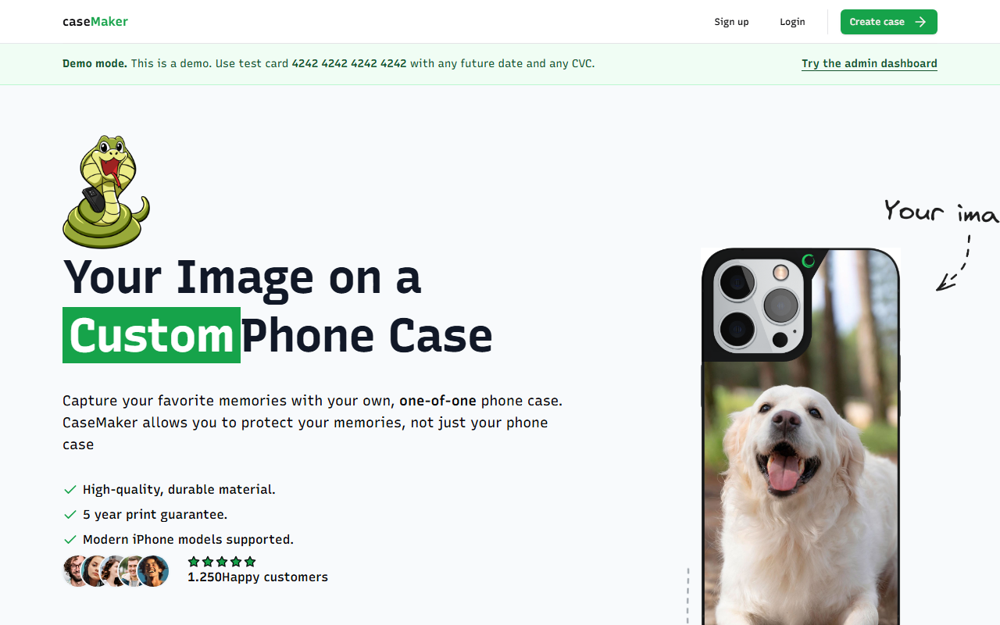
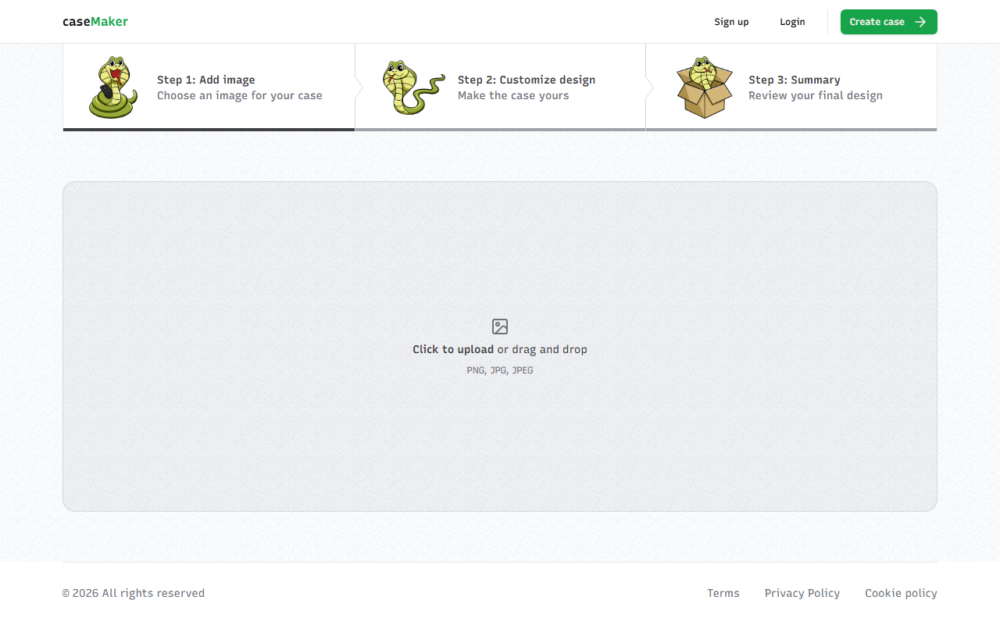
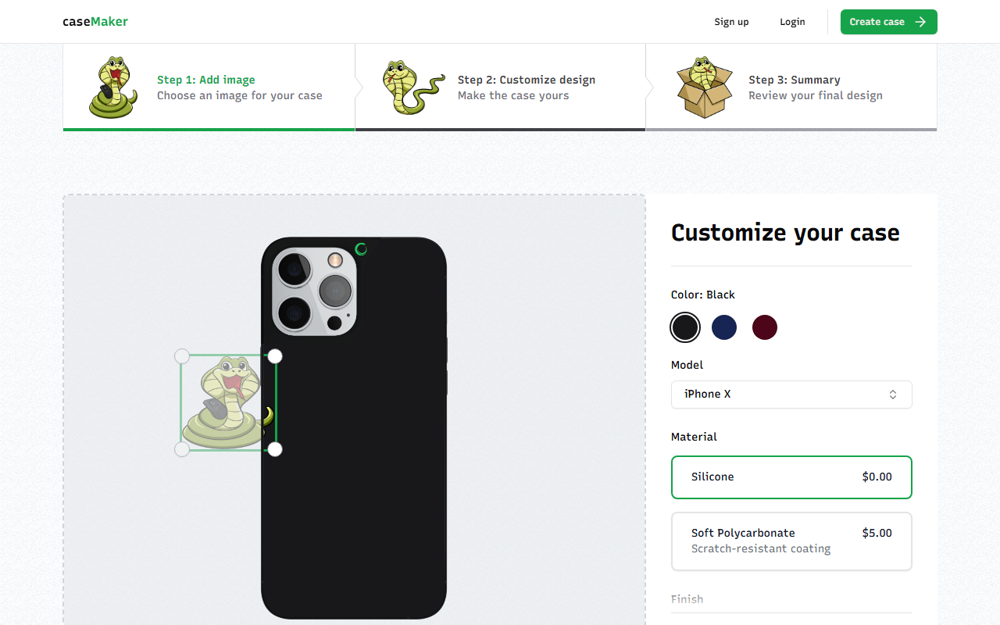
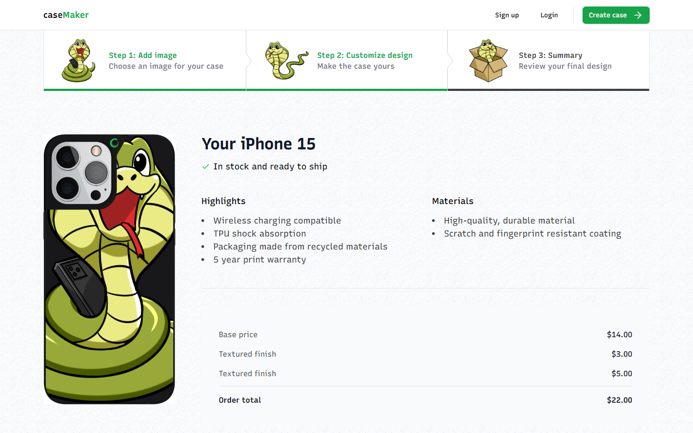
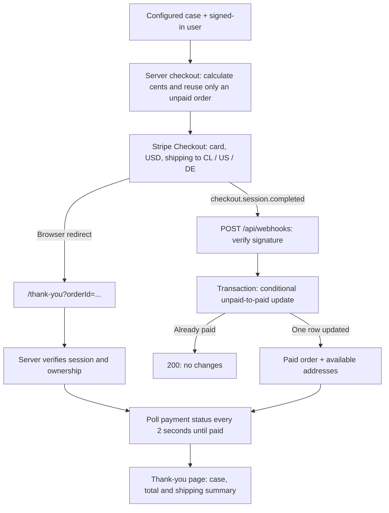

# PhoneCaseMaker

[Español](README.es.md)

A custom phone case storefront: upload an image, position it on a case, choose a model and finish, and check out with Stripe. This portfolio project focuses on payment correctness, server authorization, and a demo administration dashboard.

## Demo

<!-- TODO(owner): URL de la demo -->

The public demo link will be added once it is deployed. With `DEMO_MODE=true`, the home page displays the Stripe test card **4242 4242 4242 4242**. Use any future expiration date and any CVC in Stripe test mode.

Sign in through Kinde to complete checkout or open `/dashboard`; there is no shared administrator account. A signed-in demo visitor sees sample orders and their own paid orders, and can update only their own orders. Sample orders are read-only for everyone, including the administrator. The seed creates eight paid sample orders for three fictional `@example.com` users; these are data fixtures, not login credentials.

## Screenshots

These 1280 × 800 captures are generated with `npm run screenshots` (requires PostgreSQL).

| Home | Upload |
| --- | --- |
|  |  |

| Design | Preview |
| --- | --- |
|  |  |

## Payment flow



The browser redirect and webhook can arrive in either order. The thank-you page waits for webhook confirmation; the redirect itself does not mark the order paid.

## Engineering decisions

- **Idempotent payment processing:** a transaction runs `updateMany` with `{ id: orderId, isPaid: false }`. Only the delivery that updates one row creates and links addresses. Sequential retries and concurrent deliveries cannot create duplicate address sets. A session without shipping details still marks the order paid, without creating addresses.
- **Integer cents:** `amountCents` is an integer and the server computes prices from the saved configuration. The base price is 1400 cents, polycarbonate adds 500 and a textured finish adds 300. Checkout uses inline `price_data` and reuses only an unpaid order belonging to the same user and configuration.
- **Webhook responses:** missing or invalid signature → `400`; missing metadata, unknown order, duplicate delivery, or another event type → `200` without changes; unexpected processing errors → `500`, allowing Stripe to retry.
- **Server authorization:** dashboard reads and status writes check permissions on the server. The thank-you page and payment-status action check order ownership and return 404 for anonymous users, missing orders, or another user's order.
- **Demo dashboard:** only the exact value `DEMO_MODE=true` enables demo access for signed-in users. The administrator identified by `ADMIN_EMAIL` sees all paid orders; demo visitors see sample and own paid orders. `isSample` orders cannot be modified by anyone. The dashboard shows 7/30-day revenue, status counts, and permitted status changes.

## Stack

Next.js 15 App Router, React 18, TypeScript, Tailwind CSS and Radix UI; Prisma 5 with PostgreSQL; Kinde authentication; UploadThing image storage; Stripe 17 payments; TanStack Query for client queries. Tests use Vitest, Testcontainers and Playwright (Chromium). GitHub Actions runs CI with Node 26. Vercel + Neon is the planned deployment target.

## Run locally

Requirements: Node 26, npm, and Docker for PostgreSQL and integration tests.

```sh
npm ci
docker run --name phonecasemaker-postgres -e POSTGRES_USER=postgres -e POSTGRES_PASSWORD=postgres -e POSTGRES_DB=phonecasemaker -p 5432:5432 -d postgres:16-alpine
cp .env.example .env
npx prisma migrate deploy
npx prisma db seed
npm run dev
```

Open <http://localhost:3000>. On Windows PowerShell, use `npm.cmd` / `npx.cmd` and `Copy-Item .env.example .env`.

`.env.example` contains fictitious values. For real authentication, uploads and test checkout, fill `.env` with your Kinde application settings and callback URLs, UploadThing token, Stripe **test** secret key and webhook signing secret. Keep `NEXT_PUBLIC_SERVER_URL` and the Kinde site/redirect URLs aligned with your local origin. Set `ADMIN_EMAIL` to the intended administrator and `DEMO_MODE=true` to explore the demo. `DEMO_MODE` controls the banner and dashboard permissions; Stripe test mode depends on using test credentials.

Forward Stripe test events to `http://localhost:3000/api/webhooks` (for example with `stripe listen --forward-to localhost:3000/api/webhooks`) and set the resulting signing secret in `.env`. The relevant event is `checkout.session.completed`. Never commit credentials.

The seed can be run again: it replaces only sample orders, preserves non-sample orders, and ensures the example users/configurations exist.

## Tests and CI

```sh
npm run test:unit
npm run test:integration
npm run test:e2e
npm run screenshots
npm run typecheck
npm run lint
npm run build
```

| Suite | Coverage and prerequisites |
| --- | --- |
| Unit | Pricing and authorization rules; no database required. |
| Integration | Real PostgreSQL in a disposable Testcontainers Docker container: signed webhooks, duplicate/concurrent delivery, checkout, ownership, dashboard permissions and revenue. Docker must be running. |
| End-to-end | Four Chromium tests: home heading, demo banner, upload dropzone, and unauthenticated preview opening the login modal. A reachable PostgreSQL database is required. |
| Screenshots | Four separate `@screenshots` tests capture home, upload, design and preview into `docs/assets/*.png`. Excluded from normal end-to-end runs. |

Playwright loads `.env.example` without overriding existing environment variables. Export `DATABASE_URL` in the shell if your test database differs from the example. Its `globalSetup` runs `prisma migrate deploy`, creates a complete configuration using local `public/samples/` images, exposes its ID to workers, and deletes that configuration after the run. Use a local test database. Playwright builds and starts the app on port 3100 and sets matching application/Kinde URLs. The end-to-end suite does not automate real Kinde login or submit payments; authenticated flows are covered by integration tests. `DEMO_MODE=true` runs all four tests.

CI runs lint, type checking, unit/integration tests and a production build. A separate end-to-end job provisions PostgreSQL 16, installs Chromium and runs Playwright with fictitious service settings and demo mode enabled. On failure, it uploads `playwright-report`.

## Project structure

```text
src/app/configure/       Upload, design and checkout preview
src/app/api/webhooks/    Stripe webhook route
src/app/thank-you/       Owner-only order summary and payment polling
src/app/dashboard/      Paid-order metrics, queries and status actions
src/components/         Shared UI and server-rendered DemoBanner
src/lib/                Pricing, authorization and order processing
prisma/                 Schema, migrations and sample-order seed
tests/unit/             Pure logic tests
tests/integration/      Database-backed tests and service mocks
e2e/                    Playwright setup, browser tests and captures
docs/assets/            Generated portfolio screenshots
.github/workflows/      CI checks and end-to-end job
```

## Credits

The project started from a **public YouTube tutorial**.
<!-- TODO(owner): enlace al tutorial -->

The portfolio work adds idempotent payment processing, integer-cent money handling, server-side authorization, the dashboard with demo mode and immutable sample orders, automated tests, and CI. The original storefront/configurator foundation comes from the tutorial; these engineering additions are the project's own work.
